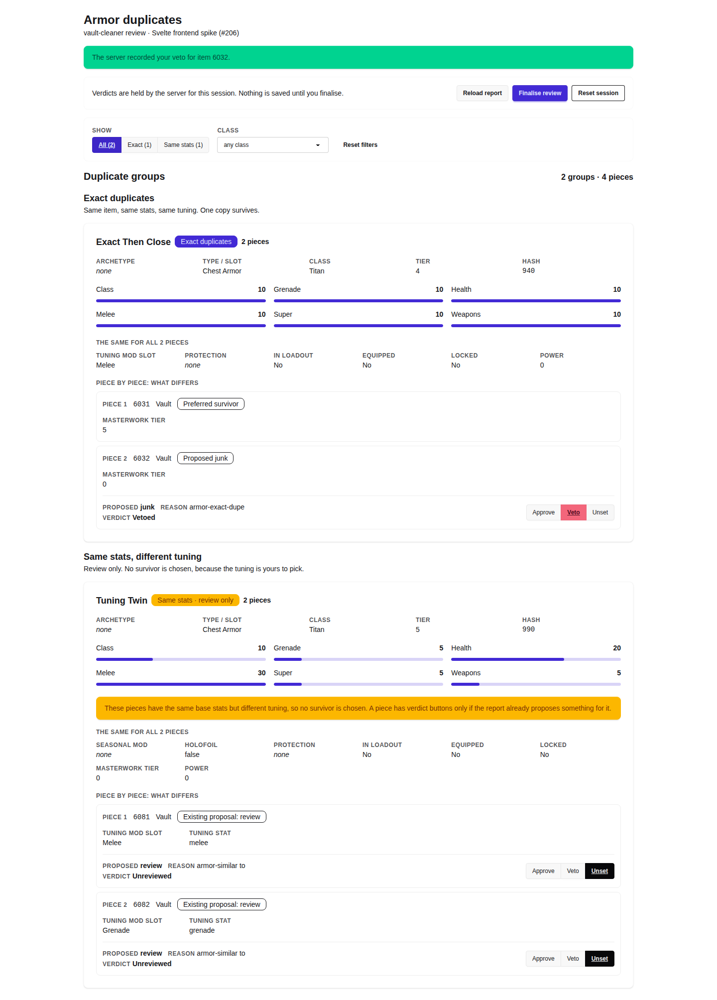
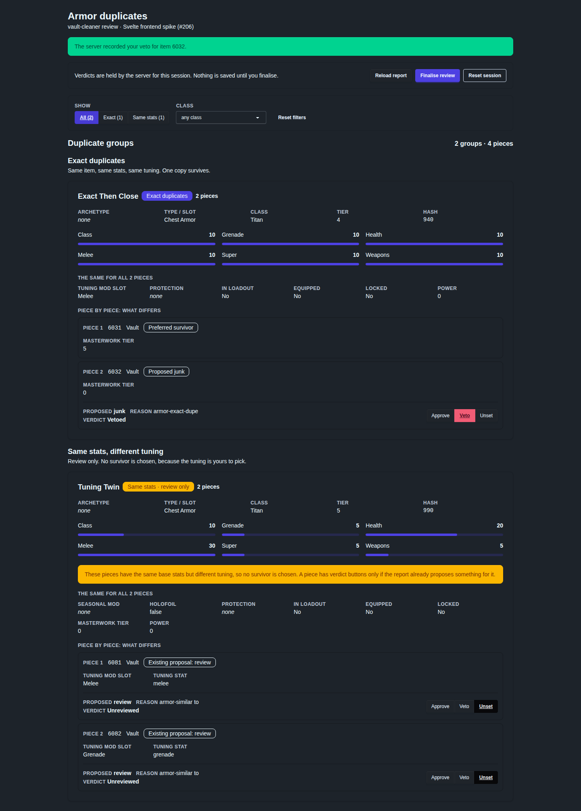
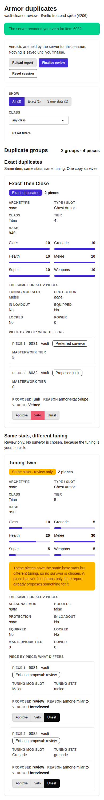
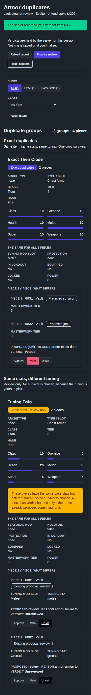

# Frontend framework decision

Status: decision record for
[#206](https://github.com/tonym999/vault-cleaner/issues/206), written
2026-10-04. It answers whether the review frontend should be rebuilt in
Svelte 5 + TypeScript + Vite, keeping Python/Flask as the backend. It changes
no production code. The migration is the ticket drafts in
[section 9](#9-migration-ticket-drafts); none has been created.

Added 2026-10-11 by [#213](https://github.com/tonym999/vault-cleaner/issues/213):
the slice as redesigned in #210 is **NO-GO as measured** against #209's
timing gate. See
[The redesigned slice against #209's gate (#213)](#the-redesigned-slice-against-209s-gate-213).
The rest of this record is #206's text, unchanged.

Every measured claim links to a transcript in
[docs/evidence/issue-206/README.md](evidence/issue-206/README.md). The proof
code is in [spikes/issue-206/](../spikes/issue-206/README.md). All data is
synthetic fixtures and the one tracked sanitised armor fixture.

## 1. Recommendation

**Bounded conditional.** Svelte 5 + TypeScript + Vite with Tailwind 4 and
daisyUI 5 remains the recommended stack, but S15 found a repeatable slowdown
on the sanitised report. Proceed with migration only after a focused
presentation-performance change passes the same whole-report comparison;
keep the current page until that gate passes. Correctness, focus, layout and
security pass. The proposed architecture remains:

- **Svelte 5 with TypeScript, built by Vite 8.** Plain Svelte, not SvelteKit.
- **Tailwind CSS 4 with daisyUI 5** for styling, on native HTML controls.
  No JavaScript component library.
- **The browser reads the existing schema-version-1 envelope** and projects
  it in typed TypeScript. No new server route and no view-model.
- **Flask serves three built files** (`.html`, `.js`, `.css`) with stable
  names from its fixed allow-list, under the **unchanged** CSP.
- **Node is a development and CI tool only.** The built files are committed
  beside the other UI resources, so an installed wheel and a Python-only
  contributor never need Node.

Eight gates pass for the Armor duplicates slice. H5 is conditional on the
real-scale performance comparison, although its layout checks pass:

| Gate | Requirement | Result | Evidence |
| --- | --- | --- | --- |
| H1 | The slice shows what the server says | Pass. Every required value equal for four fixtures, without and with verdicts, at 1440 and 390 px. S15 additionally compares every value in all 74 sanitised groups (158 members, 3401 value/role assertions per width), and all five real-upload spirit signatures; exact Seasonal Mod and positive Holofoil still rest on S1's overlay. Scope and Class options match for all nine sequences, including the real Hunter-to-Exact drop; the negative control fails | [S1](evidence/issue-206/README.md#s1-information-parity-gate-h1), [S15](evidence/issue-206/README.md#s15-real-scale-gates-h1-h4-h5) |
| H2 | Untrusted values inert; ids and hashes opaque | Pass, in two passes. With all 602 strings replaced: no element created, no dialog, no violation, ids byte-identical in the DOM, and no member has verdict buttons. With the three values that decide eligibility kept (574 strings replaced): the same, and the id is byte-identical in the verdict request body | [S2](evidence/issue-206/README.md#s2-hostile-content-gate-h2), [source rules](evidence/issue-206/README.md#source-rules-gates-h2-h8) |
| H3 | Acknowledged state only; no replay; correct across finalise, reset and disconnect | Pass. The already-open page reaches the frozen state with the revision pair unchanged | [S3](evidence/issue-206/README.md#s3-acknowledged-state-only-gate-h3), [S4](evidence/issue-206/README.md#s4-finalise-reset-disconnect-gate-h3) |
| H4 | Contract section 7 met; focus survives a verdict | Pass, with one stated change of mechanism (`aria-disabled`, [section 4](#4-design)) | [S5](evidence/issue-206/README.md#s5-focus-and-live-regions-gate-h4), [S13](evidence/issue-206/README.md#s13-automated-accessibility-check-gate-h4), [S15](evidence/issue-206/README.md#s15-real-scale-gates-h1-h4-h5) |
| H5 | Narrow layout usable; page never scrolls sideways; S15 performance condition | **Conditional.** Layout passes at 1440, 1024 and 390 px, both schemes, including all three-/four-member groups and 444 keyboard controls. S15 repeatedly renders and repaints slower than production; section 6 names the follow-up gate | [S6](evidence/issue-206/README.md#s6-layouts-gate-h5), [S15](evidence/issue-206/README.md#s15-real-scale-gates-h1-h4-h5) |
| H6 | Works from an installed wheel without Node | Pass. Chromium rendered a group and completed a verdict against the wheel, Node absent from the server's `PATH` | [S8](evidence/issue-206/README.md#s8-installed-wheel-in-a-browser-gate-h6) |
| H7 | Auth, Host, Origin and `no-store` unchanged; CSP unchanged or within the approved envelope | Pass with the **unchanged** policy. No addition is used | [S7](evidence/issue-206/README.md#s7-content-security-policy-gate-h7), [S9](evidence/issue-206/README.md#s9-request-envelope-gate-h7) |
| H8 | Maintenance effort is clearly lower | Pass, on structure and not on size. Verdict and reasons in [section 6](#6-comparison) | [S12](evidence/issue-206/README.md#s12-code-comparison-npm-tree-and-licences-gate-h8), [S14](evidence/issue-206/README.md#s14-change-exercises-gate-h8) |
| H9 | A usable development loop | Pass. Verdict and reasons in [section 6](#6-comparison) | [S10](evidence/issue-206/README.md#s10-development-loop-gate-h9), [S11](evidence/issue-206/README.md#s11-type-drift-gate-h9) |

No stop condition was reached in this attempt. The first attempt stopped at
the licence stop condition; the plan's Amendment 3 records the owner's
decision.

The exact production policy the recommended stack needs is the one
production has today:

```text
default-src 'none'; script-src 'self'; style-src 'self'; connect-src 'self'; object-src 'none'; base-uri 'none'; frame-ancestors 'none'; form-action 'none'
```

The development experience is the owner's to judge. The try-it command and a
short "make a change yourself" walkthrough are in
[spikes/issue-206/README.md](../spikes/issue-206/README.md).

## 2. Architecture

### The five questions

**1. Where the projection lives: in the browser, from the existing
envelope.** `GET /api/report` and the three mutation routes are used
unmodified. [view.ts](../spikes/issue-206/frontend/src/lib/view.ts) is a set
of pure functions from the adopted envelope to what the components print.

The alternative, a server JSON view-model joined in the browser with
`verdicts`, `state` and `override_status`, was not built. It would add a
route, a Python builder (#137's was 474 lines), a second contract to keep in
step with the first, and the problem #137's review found: `POST
/api/finalize` changes `state` and `override_status` and moves neither
revision, so a view-model cached by revision goes stale. With one envelope,
adopted whole and never cached by revision, that problem has nothing to
attach to
([S4](evidence/issue-206/README.md#s4-finalise-reset-disconnect-gate-h3)).

What the browser computes, each a lookup, a count or wording:

- which verdict a member has, and whether it has an active persisted veto;
- a member's proposal, by looking its id up in its section's `decisions`;
- whether a member has verdict controls, by production's rule
  (`review_ui.js:1209-1212`, `:1289-1295`). An exact member has them when
  its `disposition` and its `proposal_action` agree (`proposed_junk` with
  `junk`, `proposed_review` with `review`) and the section's proposal for it
  carries that action. A same-stat member has them when the section's
  proposal for it is exactly `junk` or `review`. One difference: where the
  values disagree, production's normaliser rejects the whole snapshot
  (`review_ui.js:414-418`), and the slice shows that member without
  controls;
- which comparison fields have one value across a group's members and which
  differ;
- filtering, the scope sentence and facet counts;
- **one derivation the envelope does not carry:** which stat of a tier-5
  piece is primary, secondary and tertiary, from the fixed 30/25/20 spike.
  Production derives it in the browser too (`review_ui.js:806-844`). It
  exists in one language, but it is a candidate for a snapshot field.

No grouping, member order, survivor choice or disposition is computed. The
only ordering in the browser is the alphabetical order of facet options
([source rules](evidence/issue-206/README.md#source-rules-gates-h2-h8)).

**2. How TypeScript types follow Python: hand-written types, checked against
generated samples.** [contract.py](../spikes/issue-206/contract.py) asks the
real server for two envelopes built from a fake fixture and writes them as
JSON. [samples.ts](../spikes/issue-206/frontend/src/contract/samples.ts)
assigns them to the `Envelope` type. A renamed Python field then shows in
three places before any browser runs
([S11](evidence/issue-206/README.md#s11-type-drift-gate-h9)):
`contract.py --check` fails without Node; after regenerating, the type check
fails naming the field and the type; and a unit test fails. The production
build still succeeds, because Vite does not type-check, so the type check has
to be its own CI step.

Generating the types from Python was not chosen: the snapshot is built by
hand-written dictionary code (`report_run.py:360-435`), so there is no single
Python type to generate from.

**3. Filter ownership: the browser.** Filters are pure functions over the
groups the server sent
([filters.ts](../spikes/issue-206/frontend/src/lib/filters.ts)). They work
with the server stopped
([S4](evidence/issue-206/README.md#s4-finalise-reset-disconnect-gate-h3)).

**4. How Flask serves the build: stable file names in the fixed allow-list.**
Vite is configured to write `index.html`, `assets/app.js` and
`assets/app.css`, with no content hash. Every response is already
`no-store`, so a hash would buy nothing, and stable names mean the allow-list
is three literal entries. No request value selects a file, and a file-like
query string changes nothing
([S9](evidence/issue-206/README.md#s9-request-envelope-gate-h7)).

**5. How the wheel gets the build: committed build output, with a freshness
check in CI.** Placed flat in `vault_cleaner/ui/`, the three files match
today's `package-data` globs, so `pyproject.toml` needs no change
([S8](evidence/issue-206/README.md#s8-installed-wheel-in-a-browser-gate-h6)).
A CI job would run `npm ci`, the type check, the unit tests and the build,
and fail if the committed files differ from a fresh build. Two builds on one
machine were byte-identical
([build reproducibility](evidence/issue-206/README.md#build-reproducibility));
across platforms that is not yet measured.

- **A contributor without Node can** install, run the server, run the whole
  Python and browser test suite, change any Python, and check that the
  contract samples are current.
- **A contributor without Node cannot** change the frontend source, or
  regenerate the build after a change to the envelope that the frontend
  reads.

The alternative, building in CI before packaging, would make `pip install`
from a checkout produce a server with no page unless Node were present.

**Not SvelteKit.** One page behind Flask needs no router and no server
runtime. SvelteKit's CSP support adds nonces or hashes "for any inline styles
and scripts it generates" (SvelteKit configuration reference, `csp`, read
2026-10-04), which is for markup SvelteKit renders. This application has
none: Flask serves a static file.

### State ownership

| State | Owner |
| --- | --- |
| Report, groups, members, order, dispositions, proposals, verdicts, revisions, session state, persisted vetoes | Server (unchanged) |
| The adopted envelope, replaced whole on every answer | Browser: `ReviewSession.envelope` |
| The request in flight, connection state, the status and reconciliation messages | Browser: `ReviewSession` |
| Selected kind and facet values | Browser: `ReviewSession.filters` |
| What is rendered | Svelte, from the above. No DOM is built or patched by hand |
| Focus after a report change | Browser: two effects in `App.svelte`, the slice's only direct DOM access |
| Layout at each width, light and dark scheme | CSS |

## 3. Component library comparison

Shortlist from the plan: shadcn-svelte, Skeleton and daisyUI. Each got a
probe page (button, toggle, select, overlay) under the unchanged policy; the
slice was built with one.

Documentation read on 2026-10-04:
[shadcn-svelte, Vite installation](https://www.shadcn-svelte.com/docs/installation/vite);
[Skeleton, Vite and Svelte installation](https://www.skeleton.dev/docs/svelte/get-started/installation/vite-svelte);
[daisyUI, install](https://daisyui.com/docs/install/) and
[themes](https://daisyui.com/docs/themes/).

| | shadcn-svelte 1.7.0 (Bits UI 2.19.5) | Skeleton 5.0.1 | daisyUI 5.7.47 |
| --- | --- | --- | --- |
| What it is | Component source copied into the project by a CLI, built on headless Bits UI | Tailwind design system (classes for buttons, cards, selects) plus interactive Svelte components | A Tailwind plugin: class names on native elements. No JavaScript of its own |
| Svelte 5 | Yes (peer `^5`) | Yes (peer `^5.40`) | Not applicable: it is CSS |
| Licence | MIT. Its default preset also adds an OFL-1.1 web font | MIT | MIT |
| CSP, measured | No violation. Sets styles through the CSSOM | No violation | 31 `img-src` violations from one `data:` texture; cleared by `img-src 'self' data:`, or by a one-line override under the unchanged policy |
| Probe size (page's own JS / CSS) | 203 kB / 32 kB | 66 kB / 143 kB | 1 kB / 61 kB |
| Styling effort | Low per component, but each one adds files to own: 31 files and 717 lines for button, toggle, select and dialog | Low; one theme import | Low; themes for light and dark follow `prefers-color-scheme` from one config line |
| Keyboard and focus | Bits UI provides it for custom widgets (its select is not a native select) | Zag.js provides it for its components; buttons and selects are native | Native elements, so the browser's own |
| Accessibility | From Bits UI, for the widgets it has | From Zag.js, for the widgets it has | Native semantics. Colour contrast is the project's to check: the default dark `primary` measured 4.1:1 |
| Maintenance | Generated files to keep or regenerate; the CLI is interactive and reads a remote registry | A package and many small Zag.js packages to update | One development dependency |

The probe figures and violations are in
[S7](evidence/issue-206/README.md#s7-content-security-policy-gate-h7).

**daisyUI was used, and is recommended.** This page is buttons, a select,
badges, cards and notices. Native controls already give the keyboard, focus
and screen-reader behaviour the design contract requires, and a headless
widget library would add 66 to 203 kB of script to replace elements the
browser provides. daisyUI adds none.

If a later surface needs a widget HTML does not have (a combobox, a menu
with roving focus), **Bits UI is the measured fallback**: it ran under the
unchanged policy with no violation. Prefer native `<dialog>` and `<details>`
first.

**Plain Svelte 5** needs nothing from the policy either: scoped styles are
extracted to the stylesheet, `style:` directives and `style` attributes are
applied through the CSSOM, and transitions use the Web Animations API
([S7](evidence/issue-206/README.md#s7-content-security-policy-gate-h7)).

## 4. Design

### The contract, classified

[docs/review-ui-design-contract.md](review-ui-design-contract.md) binds for
behaviour, accessibility and security. Its presentation is free (owner
decision, #206).

| Contract | Binding or free | In the slice |
| --- | --- | --- |
| Section 1, levels 2 to 4 | Binding | Kept: the server is the authority for data, counts, order, disposition, eligibility, acknowledgement and stale state |
| Section 1, level 1 (the prototype as visual target) | Free | Replaced by daisyUI's default light and dark themes |
| Section 4: tokens, colours, type, spacing | Free | Replaced |
| Sections 5.1 to 5.10: anatomy and composition | Free | Replaced; listed below |
| Section 5.11: controls only on proposal members; read-only members show status | Binding | Kept (S1 asserts it per member) |
| Section 6: icons | Free | No icon is used |
| Section 7: skip link, focusable `h1`, `role="status"` regions, `aria-pressed`, real labels, visible focus, a verdict never rebuilds the focused element | Binding | Kept (S5, S13) |
| Section 8: the page never scrolls sideways; ids, hashes and reasons wrap | Binding | Kept (S2, S6) |
| Section 8: breakpoints and the two-table matrix | Free | Replaced |
| Section 9: an empty state says why | Binding | Kept: four states, each with its reason |
| Section 10 constraints | Binding | Kept. No inline style is hand-written; none is generated either |
| Section 11: no analytics, telemetry or remote resources | Binding | Kept (S7 lists every request) |
| Section 12, questions 1 to 5 | Free | Answered by the choices below |

### Presentation choices changed

1. **Visual target.** daisyUI's `light` and `dark` themes, following
   `prefers-color-scheme`. The dark `primary` is darkened,
   because the default measured 4.1:1 against its text
   ([S13](evidence/issue-206/README.md#s13-automated-accessibility-check-gate-h4)).
   S15 exposed two more contrast defects: the default acknowledged Approve
   label at 4.46:1 and tier-5 outlined stat-role text at 2.39:1 in dark mode.
   Two narrow stylesheet overrides darken success text and lighten outlined
   primary badge text. Their whole-report axe/contrast checks pass after the
   fix; no layout or component markup changed. System fonts; no web font.
2. **The comparison matrix is gone.** Production builds two tables per group
   and switches orientation with container queries. The slice has one
   structure: values that are the same for every piece are listed once under
   "The same for all N pieces"; each piece then shows only what differs.
   Pieces are stacked in one column at every width, and their fields line up
   in a grid, so differences are compared by reading down.
3. **Identical values are a labelled list,** not production's one-sentence
   "Identical across all pieces" line.
4. **Tuning Stat is always shown** (once if shared, per piece if not).
   Production shows it only when it tells apart members with the same slot.
   This is a superset.
5. **Stats.** All six base stats with a bar each, and a `primary`,
   `secondary` or `tertiary` badge on a tier-5 spike. Production shows three
   spike bars and a sentence for the zero stats.
6. **Member status.** One badge: the server's disposition for an exact
   member ("Preferred survivor", "Retained, protected", "Proposed junk",
   "Proposed review"); "Existing proposal: review" or "Comparison only" for a
   same-stat member. Production's separate "Read-only" badge is dropped; a
   read-only member that has a proposal says so in a sentence.
7. **Proposal and verdict.** Every member with a proposal shows the proposed
   action, the reason and the verdict as labelled text, including members
   with buttons. Production shows the reason only on read-only members.
8. **Verdict wording.** `Unreviewed`, `Approved`, `Vetoed`. The persisted
   veto is its own sentence ("A veto saved from an earlier review still
   suppresses this item."), not a suffix.
9. **Absent values** read `none` or `unknown` in italics. Production writes
   `none/unknown` or `—` in the normal face. The server's own `none/unknown`
   sentinel for Tuning Mod Slot is shown as it arrives, in italics.
10. **Group kind control.** Three joined `aria-pressed` buttons with the
    count in the label (contract question 2). The pressed button is also
    bold and underlined, so colour is not the only cue.
11. **Session actions** sit in one card with the session note (contract
    question 5). "Reload report" is new. After finalising, the Finalise
    button is replaced by a download link to `/api/finalized.csv`.
12. **Status and notices** are coloured notices; the three live regions
    keep their roles and are never recreated.
13. **Same-stat notice and section copy** are reworded.
14. **Focus indicator.** One global rule outside the cascade layers: a 3px
    outline in the theme's base-content colour, 2px offset. Independent review
    found daisyUI's component rule overriding the old layered floor: dark
    primary controls had a 2px outline at 2.40:1. S13 recreates that failure
    as a negative control and measures actual Tab-focused links, selects and
    buttons in each state; S15 applies the same check to all 444 controls.
    The corrected primary rings measure 17.72:1 light and 14.75:1 dark.
    This meets the contract's floor and the [3:1 authored focus-indicator
    requirement](https://www.w3.org/WAI/WCAG22/Understanding/non-text-contrast.html)
    (read 2026-10-04). Fills and text colours did not change for this repair.

### One change of mechanism in a binding item

Section 5.11 says verdict buttons are disabled while a request is in flight
and when the session is frozen. The slice marks them `aria-disabled="true"`
and ignores the action, instead of setting the `disabled` property. Measured
in the pinned Chromium: a focused button that becomes `disabled` loses focus
to `<body>`
([S5](evidence/issue-206/README.md#s5-focus-and-live-regions-gate-h4)), which
would break "a verdict repaint never rebuilds the focused element" in
spirit. With `aria-disabled` the focused button is the same node before,
during and after the request. The button stays in the tab order while it is
off. This is a choice for the owner to confirm.

### Screenshots

Fake fixtures, one veto recorded.

| | Light | Dark |
| --- | --- | --- |
| Desktop, 1440 px |  |  |
| Narrow, 390 px |  |  |

The four-member group:
[desktop](evidence/issue-206/four-members-desktop-light.png),
[narrow](evidence/issue-206/four-members-narrow-light.png).

### Sanitised report screenshots

Each image is only the top 2,400 px of the report (the first groups), not
all 74 groups: full-page captures were about 7 MB each and were removed for
size. The automated geometry and oracle checks cover every group; the
acknowledged verdict on the final group is checked, not pictured.

| Desktop | 390 px |
| --- | --- |
| [Light, top of report](evidence/issue-206/real-desktop-light.png) | [Light, top of report](evidence/issue-206/real-narrow-light.png) |
| [Dark, top of report](evidence/issue-206/real-desktop-dark.png) | [Dark, top of report](evidence/issue-206/real-narrow-dark.png) |

## 5. Browser responsibility keep/remove map

The ten responsibilities and their line ranges are #137's
([docs/review-rendering-architecture.md, section 5](review-rendering-architecture.md#5-javascript-keepremove-map)),
checked again at this head by
[#137's range proof](evidence/issue-206/README.md#keepremove-line-ranges).
`S` is `review_server.js` (1,793 lines); `U` is `review_ui.js` (1,851).
Nothing moves to Python in this design.

| # | Responsibility | Current code | Lines | Becomes |
| --- | --- | --- | --- | --- |
| 1 | Bootstrap and session establishment | `S:81-120`, `S:128-212`, `S:312-413`, `S:1773-1792` | 247 | **Application code,** smaller. State is the fields of `ReviewSession`. Envelope validation (`S:128-212`) becomes the type contract plus one shape check; see the limit in section 8. The start-up code is `main.ts` (8 lines) |
| 2 | Uploads | `S:752-754`, `S:1483-1508`, `S:1760-1767` | 37 | **Application code** (a request) and **framework-managed** markup. Not built in the slice |
| 3 | Report fetching | `S:443-570`, `S:1509-1525` | 145 | **Application code:** `api.ts` (75 lines), typed results instead of thrown errors |
| 4 | Filters, sorts, search, group-kind navigation | `U:211-262`, `U:264-302`, `U:747-802`, `U:846-857`, `S:214-310`, `S:786-832`, `S:1212-1218` | 310 | **Application code** as pure functions (`filters.ts`); the controls and their state display are **framework-managed** |
| 5 | Verdict mutation and acknowledgement | `S:572-584`, `S:899-921`, `S:935-943`, `S:1526-1543`, `S:1556-1564`, `S:1737-1759`, `U:1168-1199`, `U:1790-1815` | 153 | The mutation and its gate stay as **application code** (`ReviewSession.setVerdict`). Every repaint function (`paintRow`, `paintArmorMember`, `setVerdictControlsDisabled`, `refreshMutationControls`) is **removed: framework-managed** |
| 6 | Stale-state reconciliation | `S:760-776`, `S:944-1014`, `S:1544-1555` | 100 | **Application code,** much smaller. `adopt` (`S:944-1014`) decides between rebuild, re-render and repaint; the slice's `#adopt` is three lines, because rendering follows from the envelope |
| 7 | Finalise, download, reset, shutdown | `S:585-601`, `S:777-785`, `S:851-877`, `S:1447-1482`, `S:1565-1736` | 261 | **Application code.** The slice has finalise and reset; download is a link; `--once` and shutdown are not built. The button markup (`S:1447-1482`) is **framework-managed** |
| 8 | Focus and live regions | `S:603-610`, `S:755-759`, `S:833-850`, `S:878-898` | 52 | Live regions are **framework-managed** text in persistent nodes. Focus after a report change is **application code:** two small effects in `App.svelte` |
| 9 | Responsive comparison switching | `U:1641-1648`; `review.css:364-388` | 8 | **Removed.** One structure; CSS only |
| 10 | DOM construction: duplicate groups | `U:304-624`, `U:804-844`, `U:1201-1640`, `U:1773-1788` | 818 | **Removed.** Markup is components; the 321 lines of snapshot normalisation (`U:304-624`) become types and `view.ts` |
| 10 | DOM construction: proposals | `U:87-150`, `U:982-1166` | 249 | **Removed,** in the Proposals ticket. Not built here |
| 10 | DOM construction: shell, metrics, filters, lists | `S:627-746`, `S:1015-1043`, `S:1219-1369`, `S:1370-1446`, `U:892-981` | 467 | **Removed.** The element helpers (`U:892-981`) have no equivalent |
| 10 | DOM construction: DIM search text | `U:626-739`, `U:1650-1771`, `S:1044-1211` | 404 | The query text generation stays as **application code** (pure functions); its panel is **framework-managed.** Not built here |

## 6. Comparison

### Lines

From [S12](evidence/issue-206/README.md#s12-code-comparison-npm-tree-and-licences-gate-h8).
Non-blank lines.

| | Current page | Jinja hybrid (#137) | Svelte slice |
| --- | --- | --- | --- |
| Rendering the duplicates surface | 908 lines of JavaScript | 93 lines of fragment seam in JavaScript, 474 of Python, 187 of templates | 408 of components and markup, 298 of projection, 110 of types |
| Filtering | 152 lines for six filters (#137's E10 count), partly inside the 908 | 62 (two filters) | 102 (two filters, written so a third is one entry) |
| Requests, revisions, reconciliation, lifecycle | not in the 908 | 238 lines that production already has | 277 |
| Imperative DOM calls in that code | 87 | not counted | 0 |

**The slice is not smaller.** Its rendering code is 816 lines against 908,
and the whole slice that runs or is served is 1,420 lines, because it also
contains its own session logic, stylesheet and serving code. The difference
is in kind: no line builds or patches DOM, all of it is type-checked, and
the logic is tested in process.

### The three change exercises

From [S14](evidence/issue-206/README.md#s14-change-exercises-gate-h8).
"Places" are separate edits in shipped code.

| Exercise | Current page | Jinja hybrid | Svelte slice | Incomplete version caught by |
| --- | --- | --- | --- | --- |
| 1. One more per-member value | 1 place (3 if the value were not already normalised), 1 file | 1 place, 1 file | 1 place, 1 file, and 1 test updated | Type check and a unit test |
| 2. One more filter facet | 6 places, 2 files | 9 places, 4 files | 3 places, 2 files, and 1 test added | Type check |
| 3. Reword one verdict state | 1 place | 1 place | 1 place | Type check (a missing state) |

Exercises 1 and 3 are one edit in every codebase, so the slice does not
touch fewer places there. The current page already keeps comparison axes in
one list and verdict wording in one function. What differs is what happens
when the edit is wrong: in the slice the type check names the mistake, and in
exercise 1 an existing unit test had to be updated, which is the test doing
its job. Exercise 2 is where structure shows: the current page threads a
filter through six places in two files.

The hybrid's count for exercise 2 is for adding a facet like its Class
facet. The current page's is where its existing Slot / type facet lives.

### The development loop

From [S10](evidence/issue-206/README.md#s10-development-loop-gate-h9).
Timings are from one machine and vary.

| | Measured |
| --- | --- |
| Cold production build, and a rebuild after a one-line edit | 0.8 s and 0.8 s, including starting npm |
| Output | `app.js` 63 kB (23 kB gzip), `app.css` 57 kB (10 kB gzip), `index.html` 0.4 kB |
| Type check; unit tests | 2.2 s; 1.3 s (32 tests, no browser) |
| One command to first render through the proxy | 1.3 s |
| Save a component to seeing it, no reload, server data kept | under 0.1 s |

The current page has no build and no type check; an edit is seen on reload,
and a mistake is seen at runtime or in the Node-harness tests. The hybrid
has no build either; a template edit is seen on the next request.

### Real scale beside production

[S15](evidence/issue-206/README.md#s15-real-scale-gates-h1-h4-h5) uploads all
893 rows of the tracked sanitised armor fixture without an overlay. Its 9
exact and 65 same-stat groups contain 158 member occurrences (including six
three-member and two four-member groups). Every required value matches the
independent S1 oracle. All nine E10 filter sequences match at both widths;
Hunter is dropped when switching to Exact, whose class options lack it.
All five spirit signatures are shown from the real upload.

All six width/scheme combinations fit without sideways scrolling or clipping;
Tab reaches all 444 controls in order. The final group's acknowledged verdict
keeps the focused node and its viewport position. ScrollY adjusts 20 px as the
status message wraps, through normal scroll anchoring; the target moves 0 px
in the viewport, so there is no visible jump. Whole-document axe and the
independent contrast check pass after the two narrow colour fixes above.

The comparison uses five alternating runs per page on one machine, the same
authenticated session/report, All groups, no Class selection, 1440 px/light.
Production activates its report-ready duplicates control in-page without
human or Playwright dwell. Readiness requires every group to have a laid-out
box, then records the next animation frame. Verdict timing starts when the
JSON body is decoded, before application code resumes; an observer records
the acknowledged control change and its next frame opportunity. These are DOM
and frame-opportunity measurements, not physical display scanout.

| Five-run medians | Svelte slice | Production |
| --- | --- | --- |
| Navigation to every group laid out | 200.0 ms | 150.2 ms |
| Navigation to next animation frame | 212.6 ms | 156.3 ms |
| Acknowledgement to DOM repaint | 17.9 ms | 10.3 ms |
| Acknowledgement to next animation frame | 24.8 ms | 16.7 ms |
| Document elements | 13,143 | 17,138 |

The scope differs: production also constructs the Proposals DOM and both
comparison orientations; the slice has one surface and one structure. Despite
fewer elements the slice is slower in both navigation and acknowledged repaint.
An isolated repeat confirmed the direction. This changes H5 and the
recommendation to **bounded conditional**; it does not invalidate the passing
information, focus or narrow-layout results. Before switch-over, a focused
presentation change (for example retaining report-scoped projection and
updating only verdict-dependent presentation) must remove the observed
slowdown under this comparison. If that does not suffice, measure paging or
virtualisation of whole groups, preserving within-group simultaneous values,
focus, offline filtering and scope counts. Those alternatives were not built.

### The redesigned slice against #209's gate (#213)

Added 2026-10-11. Transcripts:
[docs/evidence/issue-213/README.md](evidence/issue-213/README.md). Code:
[spikes/issue-213/](../spikes/issue-213/README.md).

**Verdict: NO-GO for the redesigned slice as measured.** It is a verdict on
this slice, on this fixture, against this bar. It is not a verdict on Svelte
or on the migration. #209's issue lets the owner accept a measured gap
explicitly; the owner has not been asked to.

**What was measured.** #210 redesigned the slice (direction D, merged in PR
#212). #209 had set a wider gate than S15's four stamps: those four (gate A)
plus three settled-frame measures (gate B), each needing the slice's median
at or under production's in each of two consecutive complete invocations.
#209's own record of that gate on the #206 design is on the unmerged branch
`feat/issue-209-svelte-perf-gate` at `ee61b07` and is not on `main`. #213 ran
the same gate proof on a byte-for-byte copy of #210's slice. The proof
differs from #209's only by printing the verdict action on each run's line
([evidence, section 7](evidence/issue-213/README.md#7-the-gate-proof-against-209s)).

**The gate.** Slice / production, medians of five alternating runs, 1440 px,
light. Five complete invocations were made, none incomplete, none discarded.
Invocation 3, on the one change tried, is in the step table below. Two more
were made while planning, with #209's unmodified proof on #210's own build;
they are in the plan and gave the same result.

| | Baseline 1 | Baseline 2 | Final 1 | Final 2 |
| --- | --- | --- | --- | --- |
| A1 navigation to every group laid out | 229.2 / 144.0, **+85.2** | 240.8 / 148.3, **+92.5** | 238.4 / 146.7, **+91.7** | 235.1 / 150.7, **+84.4** |
| A2 navigation to next frame | 241.9 / 149.5, **+92.4** | 252.9 / 153.8, **+99.1** | 251.8 / 153.0, **+98.8** | 247.3 / 156.6, **+90.7** |
| A3 acknowledgement to DOM | 7.2 / 9.9 | 7.4 / 9.7 | 6.8 / 9.8 | 7.4 / 10.1 |
| A4 acknowledgement to next frame | 12.1 / 18.8 | 12.3 / 18.0 | 12.2 / 14.9 | 12.1 / 15.3 |
| B1 navigation to settled | 253.9 / 159.6, **+94.3** | 261.9 / 160.2, **+101.7** | 262.8 / 163.2, **+99.6** | 259.7 / 166.3, **+93.4** |
| B2 key press to settled | 52.3 / 44.1, **+8.2** | 47.0 / 45.0, **+2.0** | 49.2 / 56.1 | 52.0 / 54.6 |
| B3 acknowledgement to settled | 29.6 / 20.5, **+9.1** | 28.4 / 20.9, **+7.5** | 29.5 / 32.0 | 29.4 / 28.8, **+0.6** |

Figures are milliseconds; a bold gap is a failed comparison. The source was
the same bytes in all four columns.

- **Navigation fails in every invocation,** by 84 to 102 ms. That alone
  decides the verdict.
- **A verdict is faster on the slice** by S15's stamps (A3, A4) in every
  invocation.
- **B2 and B3 changed result with no change to either page.** The settled
  stamp is the second of two nested animation frames, so it lands on a frame
  boundary. Acknowledgement to settled falls in two groups about a frame
  apart on both pages: under 25 ms, or 26 ms and over. Across all five
  invocations production was in the lower group in 13 of 25 runs and the
  slice in 5 of 25. Which side production's median fell on decided the
  comparison. The final invocations, run by run:

  | Acknowledgement to settled, ms | Slice | Production |
  | --- | --- | --- |
  | Final 1 | 23.5, 29.5, 29.8, 31.1, 26.1 | 34.1, 32.0, 28.6, 23.7, 33.7 |
  | Final 2 | 21.3, 29.8, 29.7, 29.0, 29.4 | 30.5, 21.1, 31.7, 28.8, 23.3 |

  | Key press to settled, ms | Slice | Production |
  | --- | --- | --- |
  | Final 1 | 39.4, 52.9, 55.1, 49.2, 48.3 | 59.7, 56.1, 55.2, 48.3, 58.0 |
  | Final 2 | 39.7, 53.6, 46.7, 52.3, 52.0 | 55.9, 43.2, 56.2, 54.6, 50.5 |

  Chromium's own counters over the same verdict window show about the same
  work on both pages: in the four invocations on the unchanged source,
  main-thread task time was 34 to 40 ms on the slice and 39 to 42 ms on
  production, and style recalculation 1.0 to 1.2 ms against 3.0 to 3.3 ms.
  B3's +0.6 ms in the last invocation is a failure by the rule and is
  recorded as one.

**Where first-render time goes.** Measured by `proof_attribution.py`
([evidence, section 4](evidence/issue-213/README.md#4-attribution)), on the
unchanged slice. Medians of five fresh documents, from its fourth run, which
was made after the one change had been tried and taken out.

The attribution harness answers each page's document and static files
through Playwright's request interception, so that it can swap in variant
files. Interception costs time: in that run it added 10.0 ms to the slice's
`ready` and 6.7 ms to production's, and moved each page's report request
6 to 8 ms later. Both pages are intercepted alike in the fourth run. In the
first three runs only the slice was, which the independent review found;
their slice-against-production figures are biased against the slice by about
that much and are not used here. So the figures in this part are comparable
with each other and are a little higher than the gate's, which intercepts
nothing.

| To the settled frame, both pages intercepted | Slice | Production |
| --- | --- | --- |
| Report request starts | 48.1 ms | 28.9 ms |
| Report has arrived | 61.9 ms | 46.5 ms |
| Every group in the document | 144.7 ms | 102.2 ms |
| Every group laid out (`ready`) | 246.3 ms | 156.7 ms |
| Script | 96.5 ms | 23.1 ms |
| Layout | 76.3 ms | 47.6 ms |
| Style recalculation | 30.6 ms | 15.2 ms |
| Main-thread task time | 246.1 ms | 147.3 ms |
| Elements | 13,019 | 17,138 |

The script, layout and style rows do not depend on interception: each was
the same to within 5 ms across all four runs, and they match the gate's own
counters. Task time does move with interception, by about 7 ms.

The slice's main thread is busy from start to finish: task time equals the
time to `ready`. Of the 90 ms between the two `ready` stamps, the report
arriving later is 15 ms (the 144 kB script has to load and run before the
request is made; without interception the request started 16 ms later than
production's). Building the document from the report takes 83 ms against
56. Styling and laying it out takes 102 ms against 55. The last two are the
bulk of the gap, and they are what the counters show: script +73 ms, layout
+29 ms, style +15 ms.

**The floor.** The slice's own rendered markup and its own stylesheet, with
no framework at all: the script is replaced by one that waits for the same
report and assigns the markup. Every element's box is identical to the
slice's. With both pages intercepted, the floor reached `ready` in 180.8 and
181.0 ms and production in 156.2 and 154.2 ms: 25 and 27 ms slower. The
floor also fetches its 1 MB of markup through the interception, which
production has no equivalent of, so that margin is an upper estimate. The
counters carry no such bias. The floor spends 74 to 76 ms on layout and 30
to 33 ms on style with about 1 ms of script, in every run: 105 to 110 ms.
Production spends 84 to 88 ms on script, style and layout together. **With
no client code left to remove, the redesigned document still costs about
20 ms more main-thread work than the whole of production's load.** No change
to the slice's script alone can pass A1.

**Ablations.** One suspected cause removed at a time, against the unchanged
build in the same alternation, through the attribution harness and not
through the gate. Every arm in these comparisons is the slice or the floor,
intercepted alike, so all three complete runs count. The unchanged arm's own
`ready` median moved between 241 and 262 ms across comparisons, so a
difference under about 15 ms between two arms is not a finding.

| Removed | Moves `ready` by | What the counters show |
| --- | --- | --- |
| Class merging per badge (`tailwind-merge`, the cause #210 guessed) | -3.9, -11.4, -9.0 ms | script -1.9, -6.3, -2.0 ms |
| The `Value` component, written out inline | -1.2, -15.6, -11.2 ms | script -0.7, -5.7, -7.7 ms |
| Report requested before mounting | -1.7, -9.3, -7.3 ms | script -0.7, -3.9, -3.1 ms |
| A preload hint for the report | +0.9, +5.1, +2.4 ms | the report arrives 39 to 43 ms earlier, still one request, and `ready` does not move: the main thread is busy anyway |
| Container queries, resolved for this width | -4.4, -5.0, -13.0 ms on the slice; -19.5, +0.6, +2.5 ms on the floor | style down 8 to 10 ms, in every run |
| The comparison grid as plain blocks (changes the layout) | -6.2, -1.4 ms on the floor | layout down 5 ms, both times |
| Every grid as plain blocks (changes the layout) | -21.5, -14.5 ms on the floor | layout down 19 and 20 ms, to 56 to 57; production 47 to 48 |

The figures in a cell are the complete runs in order. The grid ablations
exist in the last two runs only. In the second of the three runs the
unchanged arm's own script counter was 6 ms higher than in the first (101.6
against 95.4 ms), so that run's larger figures are partly that arm moving.

Read against the baseline spread, which is 11.6 ms on the slice's A1 median:
of the allowed candidates, the `Value` ablation passed it once (-15.6 ms)
and container queries once (-13.0 ms), and none did in every run. None was
measured through the gate. What the counters show consistently is small: class merging, the
`Value` component and request order are each a few milliseconds of script;
container queries are 8 to 10 ms of style; the page's grids are about 19 ms
of layout. The grids are the layout the owner accepted in #210, which lines
pieces up row by row.

In the profile, of the script time inside the bundle, Svelte's runtime is
53 to 58 ms of samples, `tailwind-variants` and `tailwind-merge` together
about 13, and all of the slice's own modules 14 to 19. Those are proportions
from a sampling profile, not timings.

**Not attributed.** About 7 ms of style beyond production's that container
queries do not explain. About 9 ms of layout beyond production's that
remains with every grid as a block. Garbage collection was 11 to 15 ms of
profile samples and was not tied to a cause. Which part of Svelte's runtime
the mount spends its time in was not broken down further, because no allowed
change follows from it.

**Steps.**

| Step | What | Result |
| --- | --- | --- |
| 0 | Baseline on the unchanged copy, two invocations; all thirteen proofs | Gate fails as above; proofs pass |
| 1 | Attribution | As above |
| 2 | Class string merged once per distinct input. Rendered markup identical. Gate invocation 3: A1 236.2 / 148.5, +87.7; A2 +95.9; B1 +99.0; A3 and A4 pass; B2 53.2 / 54.7, -1.5; B3 29.6 / 30.6, -1.0 | **Dropped** (see below) |
| 3 | Two final invocations on the unchanged source | Gate fails |

**Why the change was dropped.** The plan keeps a change only if it moved a
gated comparison by more than the spread between the two baseline
invocations. Read literally, invocation 3 met that on two comparisons: B2
went from +8.2 and +2.0 to -1.5, and B3 from +9.1 and +7.5 to -1.0, both
from fail to pass. That is not credited to the change, for a measured
reason: the two final invocations, on the unchanged source, show the same
movement without it (B2 -6.9 and -2.6; B3 -2.5 and +0.6). The baseline
spread on B2 and B3 understates how far those two comparisons move on their
own, because they turn on which frame production's median lands in. On the
navigation comparisons, the ones that fail by 84 ms and more, A1 on the
slice was 236.2 ms, between the two baseline values of 229.2 and 240.8.

No other change was built. Each remaining allowed candidate has an ablation
above. By the counters each is worth a few milliseconds, and together
roughly 10 to 25 ms depending on the run, against navigation gaps of 84 ms
and more, so none was taken to the gate. Rendering containment, deferred or chunked mounting, paging and
virtualisation were excluded by the plan and were not measured.

**The order of work.** The plan asked for the attribution to be committed
before any change to the slice. No commit changes the slice, so history
cannot show that order; the attribution's first three runs were made before
the change was tried, and its fourth after the review.

**What a pass would need.** Not a faster script alone: the floor fails. A
passing slice would need less layout and style than the accepted design
costs, or less of it at load. Both are outside what #210's constraints allow
this ticket to change, and both are the owner's decision.

**The slice is unchanged,** so #210's proofs hold as recorded: S1 to S6, S15,
the source scan, and #210's four own proofs each pass against this build,
and each printed the hashes of the files it was served
([evidence, section 3](evidence/issue-213/README.md#3-every-proof-on-the-unchanged-copy)).
They were run at the baseline and again in the fix round after the review,
on the same bytes both times. The visual comparison the plan required for a
changed slice was not needed. Lines added to the slice: none. H8 is not
affected.

### H8: is maintenance effort clearly lower? Yes, on structure

- **(a) No grouping, ranking, survivor or eligibility rule is in both
  Python and the browser.** The browser reads groups, order, dispositions
  and proposals. It does hold knowledge of the server's values, which a
  change on the Python side could silently outdate:
  - the tier-5 stat roles, derived from the 30/25/20 spike (not in Python's
    output at all);
  - the `none/unknown` sentinel for Tuning Mod Slot, copied from
    `duplicate_reference.py:34`;
  - the convention that a Holofoil value of `false` means "not holofoil";
  - the names of enumerated values: the frozen states (`finalized`,
    `closed`), the dispositions and their pairing with `junk` and `review`,
    the override status `active`, and the verdicts `approved` and `vetoed`.

  These are names and conventions, not decisions, but they are a second
  copy. The type contract does not cover them (see H9).
- **(b) No hand-written DOM construction or repaint.** Zero imperative DOM
  calls against 87 in the code it replaces. The listed exceptions are the
  mount point and the focus policy
  ([source rules](evidence/issue-206/README.md#source-rules-gates-h2-h8)).
- **(c) Fewer places in one exercise of three, the same in two,** for the
  reason given above.
- **(d) The remaining application logic is typed and unit-tested without a
  browser:** held responses, stale revisions, a finalise made elsewhere, a
  stopped server, in 32 tests that run in 1.3 s.

It is **not** lower on size, and it adds a toolchain to maintain
([section 7](#7-costs)). If the owner weighs a second toolchain more heavily
than hand-maintained DOM code, this gate is the one to dispute.

### H9: is the development loop usable? Yes

- One command starts it (`dev.py`).
- A component edit was visible against real server data in under 0.1 s,
  without a reload.
- A Python-to-browser type mismatch is caught before runtime, by a
  Python-only check and by the type check. This covers field names and
  field types. It does **not** cover enumerated values: they are typed
  `string`, so a renamed `state`, `disposition`, override `status` or
  `verdict` value passes the type check. The stale-sample check
  (`contract.py --check`) and the unit tests catch those (the reviewer
  renamed each in the samples: the type check passed and the unit tests
  failed every time).
- Nothing in the loop weakens the built product. The Flask server is
  unmodified. The dev proxy presents the server's `Host` and rewrites
  `Origin` only when it is exactly the dev server's own; a foreign `Origin`
  through the proxy is refused with 403. None of it is in the build.
- **In development only, one server check is replaced by a weaker one.**
  Because the proxy always presents the Flask server's `Host`, Flask's
  exact-`Host` check never sees what the browser sent. Its stand-in is
  Vite's `server.allowedHosts`, left at its default. Measured through the
  proxy: a foreign name is refused (403), but `localhost` and any
  `*.localhost` name are accepted (200), where Flask itself answers 400 to
  both.

One caveat: in development the page is served by Vite, so Flask's CSP does
not apply to it. A CSP regression shows only on the built page, so the
built-page checks (S7, S8) must run in CI.

### Development experience, including what was awkward

Good: components read like the page; state is ordinary class fields;
derived values recompute themselves, so "adopt the envelope" is the whole
reconciliation; the session class runs in plain Node for tests; hot reload
keeps the session.

Awkward, each found by a proof:

- **`disabled` drops focus.** Found by S5; needed `aria-disabled`.
- **Tailwind reads class names from any text.** A `data-empty="loading"`
  attribute pulled in daisyUI's `.loading` spinner with a `data:` image.
  The stylesheet also changed with unrelated files until its sources were
  restricted to the shipped source (`app.css`).
- **daisyUI's `data:` texture** needs one override to keep the policy
  unchanged, and its default dark `primary` fails AA contrast.
- **axe cannot judge contrast on daisyUI's buttons, badges and notices**
  (they declare `background-image: none`); the proof measures those itself.
- **lightningcss writes helper properties into the stylesheet** under
  Vite's default CSS target. A modern `cssTarget` stops it
  ([S12](evidence/issue-206/README.md#s12-code-comparison-npm-tree-and-licences-gate-h8)
  checks for traces).
- **Typing JSON samples** means enumerated values are typed `string`, and
  narrowed where they are used.
- **The shadcn-svelte CLI** is interactive, and its default preset adds a
  web font.
- **TypeScript 7 cannot be used yet:** `svelte-check` peers 5 or 6.

## 7. Costs

- **Node in development and CI.** A CI job for `npm ci`, the type check,
  unit tests, the build, the committed-build freshness check, the source
  scan and the licence scan. Python-only work needs none of it.
- **The dependency tree.** 11 direct development dependencies, all pinned
  exactly; no runtime dependency. 76 packages installed, 122 in the
  lockfile (the rest are other platforms' optional binaries). `npm audit`
  reported no vulnerability on 2026-10-04.
- **Licences.** The installed tree is MIT, Apache-2.0, BSD-3-Clause and ISC,
  plus MPL-2.0 for `lightningcss` (required by Vite 8 and Tailwind 4) and
  `axe-core`, both build-time or test-time only. The built output contains
  Svelte, `clsx`, Tailwind and daisyUI, all MIT
  ([S12](evidence/issue-206/README.md#s12-code-comparison-npm-tree-and-licences-gate-h8)).
- **Lines to amend.** `PLAN.md:59` and `AGENTS.md:44` say dev and test
  tooling is pytest, ruff and Playwright. Both need the Node toolchain named
  as development and build tooling, with the runtime set unchanged. The
  `AGENTS.md` setup block needs the npm commands, and the hard rules need
  "never hand-edit the committed build".
- **The 8,653 lines of Node-harness UI tests**
  (`tests/test_review_ui_js.py`, 3,165; `tests/test_server_ui_js.py`, 5,488)
  test the two scripts this replaces. They cannot be kept as they are.
  Behaviour they pin has to be re-expressed as frontend unit tests (logic)
  or Playwright tests (page), surface by surface, before the old scripts are
  deleted. This is the largest single cost of the migration.
- **The production CSP: unchanged.** No `SERVER_CSP` edit is needed, so no
  migration draft carries one. Two things would change that, and each would
  need its own reviewed item: removing the `--fx-noise: none` override
  (`img-src 'self' data:`), or adding a web font (`font-src 'self'`).

## 8. Limits of the evidence

- **No screen reader was run.** Node identity, roles and write counts are
  measured; what is spoken is not.
- **Chromium only,** the pinned headless build.
- **One slice.** Proposals, uploads, metrics, the DIM search panels,
  download handling, `--once` and shutdown were not built.
- **Two of the six duplicate filters** (kind and Class). Search, slot,
  archetype and tuning slot were not written; exercise 2 shows what one more
  costs. The Tuning Mod Slot facet counts pieces and matches any member of a
  same-stat group, which the facet list as written does not express.
- **Less runtime validation than production.** `review_ui.js:304-624`
  validates the snapshot and throws on an inconsistent one. The slice checks
  the envelope's outer shape and trusts the type contract. A malformed
  envelope from the same-origin server would fail in the projection, not
  with a designed message. Every value stays inert either way (S2). The
  migration must decide how much runtime validation to keep.
- **Fixtures have no read-only same-stat member and no exact survivor with
  a later proposal.** Those two cases are covered by unit tests only.
- **Exact-group Seasonal Mod and positive Holofoil still rest on S1's
  in-memory overlay and unit tests.** The sanitised fixture has no exact
  Seasonal Mod and its exact groups have Holofoil `false`; all five spirit
  signatures now come from S15's unmodified upload.
- **The stylesheet half of S12's built-output licence scan is a text match.**
  The JavaScript half reads the bundler's own module list. For the
  stylesheet the bundler lists only the entry file, because Tailwind inlines
  imports itself, so the proof reads the `@import` and `@plugin` lines of
  `app.css`. A package pulled in by an imported stylesheet, rather than
  named in `app.css`, would be missed.
- **The development loop's `Host` check is Vite's, not Flask's** (section 6,
  H9).
- **The hostile overlay is applied between server and page,** because the
  server will not hold such ids. The verdict acknowledgement in S2 is
  therefore simulated; the request body is real.
- **`stale_report` and a finalise elsewhere reach the page on its next
  request.** The page does not poll. "Reload report" is the manual route.
- **The finalise button does not save the CSV;** it shows a download link.
- **Build reproducibility** was measured on one machine.
- **Line counts** compare a spike with production code.
- **Probe package counts** per library were not put in the evidence file;
  the sizes and violations were.
- **Timings** are from one machine. S10 measures one development-loop run;
  S15 uses five alternating runs per implementation and reports medians.
  Navigation and DOM/frame timing at 1440 px/light are measured; performance
  at other widths, other machines and reports beyond this 893-row fixture
  remains unmeasured. The slower slice needs a focused follow-up before GO.
- **#213's timings** (added 2026-10-11) are one machine, the pinned
  Chromium, 1440 px, light, the one sanitised fixture. Its three
  settled-frame comparisons are quantised to an animation frame, and two of
  them changed result between invocations with no change to either page.
  Other widths, the dark scheme, other browsers, a larger report, and what
  rendering containment, deferred mounting, paging or virtualisation would
  save were not measured.
- **The full-page stacked layout is long:** about 61,000 px at desktop and
  101,000 px at 390 px. Every group is tested, but only the top 2,400 px is
  pictured, and no human task-completion or large-report navigation study
  was run.
- **The stat-role derivation** stays in the browser because the envelope
  has no field for it.

## 9. Migration ticket drafts

Drafts only. None has been created. Each is one ticket, in this order; each
depends on the one before unless it says otherwise. All inherit the hard
rules in `AGENTS.md`, and none changes the envelope, the routes, the session
lifecycle or the CSP.

### 1. M10: frontend toolchain foundation

**Scope.** A `frontend/` Vite project (Svelte 5, TypeScript, Tailwind 4,
daisyUI 5, exact versions, committed lockfile) that builds an empty shell.
The envelope types, `contract.py` and its samples. A CI job: `npm ci`, type
check, unit tests, build, committed-build freshness, contract check, source
scan, licence scan. The freshness check compares the three served files.
`dist/modules.json`, which the licence scan reads, is not served and is not
committed; its paths are relative to the frontend directory, and must stay
so (or the file must be excluded) so that nothing built depends on where the
checkout is. The `PLAN.md` and `AGENTS.md` dependency and setup
lines. The built files committed in `vault_cleaner/ui/` but served by no
route yet.

**Scope rule.** No change to any served page or route.

**Stop if** the committed build is not reproducible in CI across the
project's platforms, or a package falls outside the approved licences.

### 2. M10: session core and the Armor duplicates surface

**Scope.** The typed session (`api`, `ReviewSession`) with unit tests, and
the Armor duplicates surface with all six filters, served at a second
allow-listed path beside the current page. Playwright tests for it, taken
from the behaviours `tests/test_server_browser.py` pins for this surface.
The wheel proof extended to the new files. A decision, with tests, on
runtime envelope validation.

**Scope rule.** The page at `/` is untouched.

**Stop if** a behaviour in the design contract's binding sections cannot be
met, or the unchanged CSP cannot be kept.

### 3. M10: shell (uploads, report summary, session actions)

**Scope.** Uploads with their status regions, the report summary and
metrics, persisted-override status, finalise with download and `--once`,
download again, reset and shutdown, in the new frontend. Playwright tests
for each.

**Scope rule.** Still at the second path.

**Stop if** download or `--once` handling needs a route or lifecycle change.

### 4. M10: Proposals surface

**Scope.** Search, filters, sort, grouping, bulk verdicts, expanded detail,
and the DIM search panels. Unit tests for sort and grouping; Playwright
tests for the page.

**Scope rule.** Presentation only; proposal order and eligibility come from
the server.

**Stop if** a sort or grouping rule would have to be decided in the browser
beyond what `review_ui.js` already does.

### 5. M10: real-scale presentation performance gate

**Scope.** A focused reduction of report-wide presentation work on load and
verdict adoption, with a regression comparison against the current page on
the tracked sanitised report. Start with report-scoped projection and selective
verdict-dependent updates; measure paging or whole-group virtualisation only
if needed. Reuse S15's all-group oracle, filter, focus, keyboard, accessibility
and five-run timing checks. Keep every differing value visible per member.

**Scope rule.** Presentation performance only, on the second path; no schema,
rule, eligibility, lifecycle or protocol change.

**Stop if** the comparison still shows the measured slowdown, or an
optimization sacrifices comparison information, focus, offline filters,
scope counts or CSP. The migration remains conditional and does not switch over.

**Carried out** (note added 2026-10-11) by #209 on the #206 design, recorded
on its unmerged branch, and by #213 on #210's redesign: NO-GO as measured,
in [section 6](#the-redesigned-slice-against-209s-gate-213). The comparison
still shows the slowdown on navigation, so this draft's stop condition holds.

### 6. M10: switch over and retire the old page

**Scope.** Serve the new frontend at `/`. Delete `review_ui.js`,
`review_server.js`, `review.css`, `review_server.html` and the two
Node-harness test files, after a recorded mapping from each behaviour they
pinned to the test that now pins it. Update `scripts/check_wheel_install.py`
and the documentation.

**Scope rule.** No behaviour is dropped without a line in the mapping saying
why.

**Stop if** the mapping finds a pinned behaviour with no new test.

### 7. M10: final gate

**Scope.** The full Playwright suite against an installed wheel; an
accessibility pass that includes a screen reader, recorded in
`docs/browser-verification.md`; a repeat of the sanitised-report performance gate, plus a larger fixture
if available through approved sanitisation; and
removal of `spikes/issue-206/` and `spikes/issue-137/` or a note that they
stay as frozen evidence.

**Scope rule.** Verification and documentation only.

**Stop if** the screen-reader pass or the large report finds a defect; that
goes back as its own ticket.
